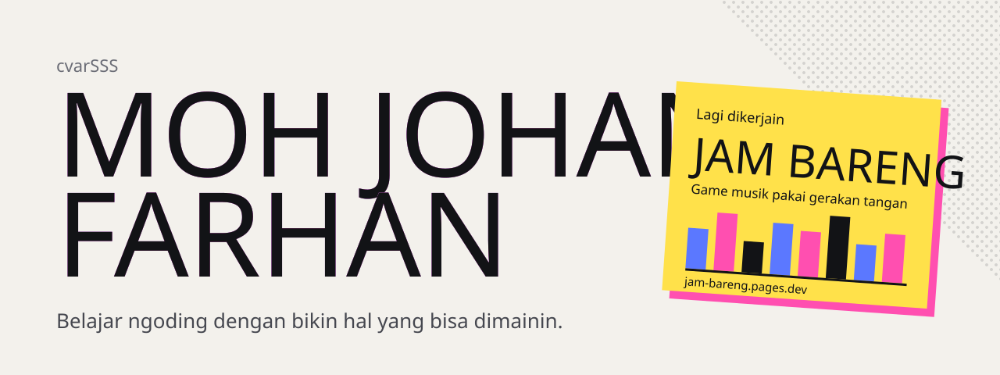
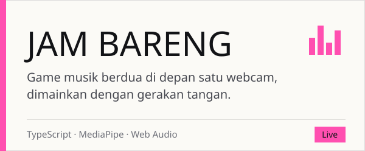
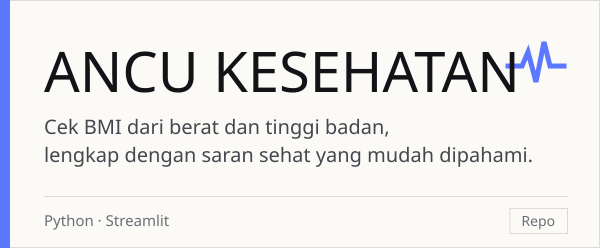
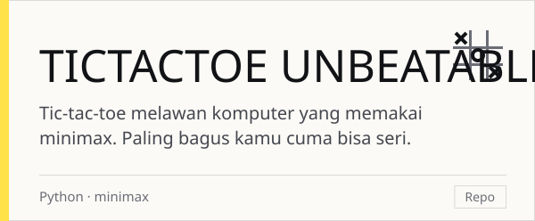
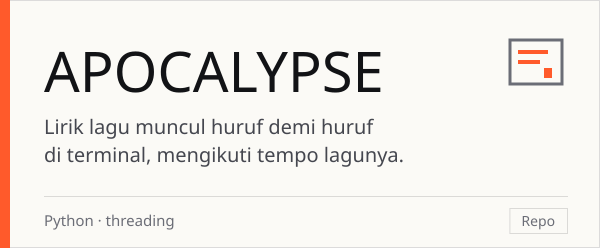

<picture>
  <source media="(prefers-color-scheme: dark)" srcset="assets/hero-dark.svg">
  
</picture>

Saya belajar ngoding dengan cara bikin hal yang bisa langsung dicoba: game, alat musik, dan aplikasi kecil yang kepakai. Yang terbaru, [Jam Bareng](https://jam-bareng.pages.dev), game musik untuk dua orang yang dimainkan dengan gerakan tangan di depan webcam.

## Proyek

  <a href="https://jam-bareng.pages.dev"><picture><source media="(prefers-color-scheme: dark)" srcset="assets/card-jam-bareng-dark.svg"></picture></a>
  <a href="https://github.com/cvarSSS/ancu-kesehatan"><picture><source media="(prefers-color-scheme: dark)" srcset="assets/card-ancu-kesehatan-dark.svg"></picture></a>

  <a href="https://github.com/cvarSSS/TicTacToe-Unbeatable"><picture><source media="(prefers-color-scheme: dark)" srcset="assets/card-tictactoe-dark.svg"></picture></a>
  <a href="https://github.com/cvarSSS/Apocalypse"><picture><source media="(prefers-color-scheme: dark)" srcset="assets/card-apocalypse-dark.svg"></picture></a>

## Alat yang saya pakai

`TypeScript` `Python` `JavaScript` `PHP` `Laravel` `MySQL`

## Satu fakta

Saya belajar karena saya malas.

## Kontak

[mohjohanfarhan@gmail.com](mailto:mohjohanfarhan@gmail.com) &nbsp;/&nbsp; [Instagram @mohjohanfrhan](https://instagram.com/mohjohanfrhan)

Aset profil ini dibuat oleh <code>build.py</code>. Font Big Shoulders Display dan Archivo memakai SIL Open Font License.
